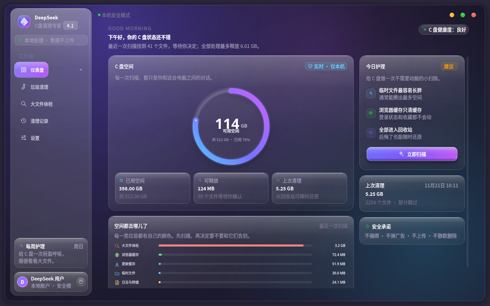

<div align="center">

# DeepSeek v4.1 C盘清理专家

**一款不吓人、不偷删、看得懂的 Windows C 盘清理工具。**

**由 DeepSeek v4.1 Flash Max 制作**

8 类垃圾扫描 · 大文件体检 · 清理记录 · 回收站可撤销删除 · 玻璃质感双主题


[](https://github.com/yzx-web/DeepSeek-CDrive-Cleaner/releases/latest)

</div>

> **非官方说明**：本项目是第三方工具，与 DeepSeek 官方及其关联公司无任何关系，也未获得其认可或背书。名称中的 “DeepSeek” 仅作为项目代号。

## 这是什么

一个把 C 盘清理做得更“可控”的 Windows 小工具：先扫描、再勾选、最后确认，所有删除都进入系统回收站。它不会替你永久删除任何东西，也不会联网上传文件路径。

界面采用 iOS 控制中心风格的毛玻璃，提供奶油浅色与深紫深色两套主题；玻璃按钮带高光、厚度阴影、渐变和细腻纹理，像可以按下去的真实按键。

## 界面预览

<p align="center">
  
  
</p>

## 下载

前往 **[Releases](https://github.com/yzx-web/DeepSeek-CDrive-Cleaner/releases/latest)** 下载 `DeepSeek-v4.1-CDrive-Cleaner.zip`。

压缩包内包含：

- `DeepSeek v4.1 C盘清理专家.exe`：Windows 10 / 11 64 位单文件，免安装
- `使用说明.txt`
- `文件校验.txt`
- `界面预览/`
- `源码/`：完整 PySide6 项目源码、图标资源、打包配置

> **SmartScreen 提示**：程序未做商业代码签名，首次运行如遇“未知发布者”，点“更多信息”→“仍要运行”。这是 Windows 对未签名 exe 的常规提示。
>
> **SHA-256**：`36c4921c2d0def64b0c145595b2f9f79472c1567325a72c2a75a96e3c8dba6b0`

## 功能

- **8 类垃圾扫描**：临时文件、回收站、Windows 更新缓存、缩略图、预取文件、浏览器缓存、系统日志与转储、大文件。
- **透明可控**：每一类都显示文件数、体积与用途；默认只勾选低风险类别，回收站与大文件不擅自处理。
- **大文件体检**：只列出超过 500MB 的文件，默认不勾选；可按类型、日期、大小筛选。
- **清理记录**：累计释放、次数、平均释放、跳过原因；可导出 TXT 报告到桌面。
- **系统集成**：系统托盘、开机自启、清理后 60 秒倒计时关机、每周日 10:00 提醒。
- **双主题玻璃界面**：自动 / 浅色 / 深色，240px 玻璃侧栏、环形空间仪表盘、自定义手绘图标。

## 安全底线

- 所有正常清理都通过 `send2trash` 调用 Windows `IFileOperation`，进入回收站，可撤销。
- 清理前必须手动勾选并二次确认；不会静默删除。
- 路径经过 realpath、白名单、用户资料目录、AppData 根目录、敏感文件名多重校验。
- 回收站类别只统计与提醒，不代用户永久清空。
- 不联网、不上传文件路径；设置与历史只保存在 `%APPDATA%\DeepSeekCleaner`。
- 日常扫描以普通权限运行，只有用户主动点击“以管理员身份重新启动”时才触发 UAC。

## 快速开始

1. 从 Releases 下载 zip，解压到任意文件夹。
2. 双击 `DeepSeek v4.1 C盘清理专家.exe`。
3. 在“垃圾清理”点“开始扫描”，或先到“大文件体检”看看谁在占空间。
4. 勾选你想处理的类别，确认后清理；完成后可打开回收站复核。

## 从源码运行

```bash
python -m venv .venv
.venv\Scripts\activate
pip install -r requirements.txt
python main.py
```

## Windows 打包

在 Windows 10 / 11 64 位、Python 3.11 环境中：

```bash
pip install pyinstaller==6.16.0
pyinstaller --noconfirm --clean build_win.spec
```

产物位于 `dist\DeepSeekCleaner.exe`，重命名为 `DeepSeek v4.1 C盘清理专家.exe` 即可分发。

## 项目结构

```text
main.py              程序入口、高 DPI、异常日志、打包自检
app_settings.py      设置、%APPDATA% 数据目录、原子 JSON 写入
scanner.py           8 类扫描、磁盘统计、大文件扫描
cleaner.py           白名单校验、敏感文件保护、回收站删除
report.py            清理报告、历史记录、导出
system_utils.py      管理员权限、开机自启、每周提醒、关机、托盘
ui/                  主题令牌、玻璃组件、图标、侧栏与 5 个页面
assets/              应用图标 PNG / ICO / 多尺寸
build_win.spec       Windows 单文件打包配置
version_info.txt     exe 文件属性
app.manifest         asInvoker + PerMonitorV2 清单
```

> 仓库中的源码与发布压缩包来自同一份构建，图标与预览图由 Release 流程自动同步。

## 兼容性

- Windows 10 / 11 64 位
- 不需要 .NET、Node.js 或单独安装 Qt
- 单文件 exe，约 26 MB
- 中文界面

## 已知说明

- 程序未做商业代码签名，SmartScreen 可能提示“未知发布者”；校验值见 `文件校验.txt`。
- 部分系统目录需要管理员权限；普通权限下会跳过并记录，不会假装成功。
- 回收站类别只做统计，不代替用户在系统里清空回收站。
- 这是一个本地工具，不提供云端账号、同步或遥测。

## 制作与版权

本软件由 **DeepSeek v4.1 Flash Max** 制作。

Copyright © 2026. All rights reserved.

本仓库公开用于查看、下载与个人使用；未附带 OSI 开源许可证，未授权再分发、商用或二次发布。如需授权，请先联系作者。
