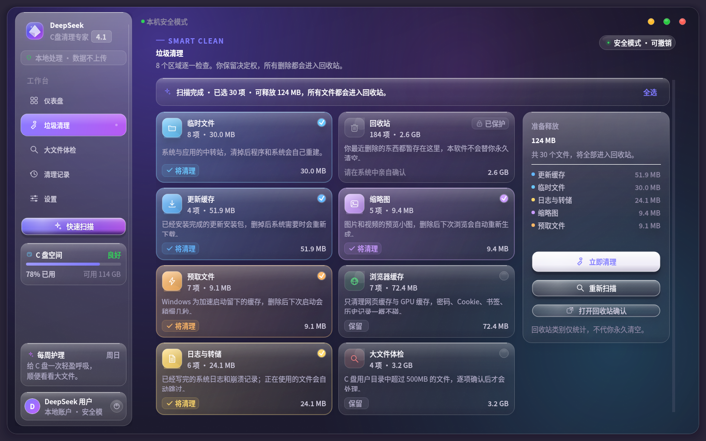

<div align="center">


# DeepSeek v4.1 C盘清理专家

**先看清，再决定。删错了，还能从回收站拿回来。**

Windows 10 / 11 64 位 · 免安装单文件 · 约 26 MB

**由 DeepSeek v4.1 Flash Max 制作**


<br />

<a href="https://github.com/yzx-web/DeepSeek-CDrive-Cleaner/releases/latest">
  
</a>
<a href="https://github.com/yzx-web/DeepSeek-CDrive-Cleaner">
  
</a>

</div>

> **非官方说明**：本项目是第三方工具，与 DeepSeek 官方及其关联公司无任何关系，也未获得其认可或背书。名称中的“DeepSeek”仅作为项目代号。

## 为什么值得一试

| 删除可撤销 | 清理看得见 | 运行不打扰 |
| :--- | :--- | :--- |
| 所有正常清理都进入 Windows 回收站，误删也能还原。 | 8 类垃圾逐项列出文件数、体积和用途，默认只勾选低风险项。 | 不联网、不上传路径、不弹广告、不捆绑安装。 |

它不是“一键加速大师”，也不会替你永久删除任何东西。它更像一张 C 盘体检表：先扫清楚，把决定权留给你。

## 界面预览

| 仪表盘 | 垃圾清理 |
| :---: | :---: |
|  |  |
| 环形空间仪表、健康度与空间去向 | 8 类彩色卡片、逐项勾选与释放摘要 |

界面采用 iOS 控制中心风格的毛玻璃：奶油浅色与深紫深色双主题，240px 玻璃侧栏、带高光与厚度阴影的玻璃按钮，以及一套手绘线性图标。

## 下载与安装

前往 **[Releases](https://github.com/yzx-web/DeepSeek-CDrive-Cleaner/releases/latest)** 下载 `DeepSeek-v4.1-CDrive-Cleaner.zip`，或直接下载当前版本：

**[DeepSeek-v4.1-CDrive-Cleaner.zip](https://github.com/yzx-web/DeepSeek-CDrive-Cleaner/releases/download/v4.1.0/DeepSeek-v4.1-CDrive-Cleaner.zip)**

压缩包内包含：

- `DeepSeek v4.1 C盘清理专家.exe`：Windows 10 / 11 64 位单文件，免安装
- `使用说明.txt`
- `文件校验.txt`
- `界面预览/`
- `源码/`：完整 PySide6 项目源码、图标资源、打包配置

> **SmartScreen 提示**：程序未做商业代码签名，首次运行如遇“未知发布者”，点“更多信息”→“仍要运行”。这是 Windows 对未签名 exe 的常规提示。
>
> **SHA-256**：`36c4921c2d0def64b0c145595b2f9f79472c1567325a72c2a75a96e3c8dba6b0`

## 30 秒了解

| 能力 | 你会得到什么 |
| :--- | :--- |
| **8 类垃圾扫描** | 临时文件、回收站、Windows 更新缓存、缩略图、预取文件、浏览器缓存、系统日志与转储、大文件。 |
| **透明可控** | 每一类都显示文件数、体积与用途；默认只勾选低风险类别，回收站与大文件不擅自处理。 |
| **大文件体检** | 只列出超过 500MB 的文件，默认不勾选；可按类型、日期、大小筛选。 |
| **清理记录** | 累计释放、次数、平均释放、跳过原因；可导出 TXT 报告到桌面。 |
| **系统集成** | 系统托盘、开机自启、清理后 60 秒倒计时关机、每周日 10:00 提醒。 |
| **双主题玻璃界面** | 自动 / 浅色 / 深色，240px 玻璃侧栏、环形空间仪表盘、自定义手绘图标。 |

## 清理范围与默认策略

| 类别 | 清理什么 | 默认 |
| :--- | :--- | :---: |
| 临时文件 | 系统与应用的中转文件，关闭软件后基本无用 | ✅ 勾选 |
| Windows 更新缓存 | 已安装完成的更新安装包，需要时会重新下载 | ✅ 勾选 |
| 缩略图缓存 | 图片与视频预览小图，下次浏览会自动重建 | ✅ 勾选 |
| 预取文件 | Windows 启动加速缓存，删除后下次启动可能慢几秒 | ✅ 勾选 |
| 日志与转储 | 已写完的系统日志和崩溃记录，正在写入的自动跳过 | ✅ 勾选 |
| 浏览器缓存 | 只清网页缓存与 GPU 缓存，不碰密码、Cookie、书签、历史 | ⬜ 手动勾选 |
| 大文件体检 | C 盘用户目录中超过 500MB 的文件，逐项确认后才处理 | ⬜ 手动勾选 |
| 回收站 | 只统计大小并提醒，不代替用户在系统中清空 | 👁 仅统计 |

## 安全底线

1. **删除可逆**：所有正常清理都通过 `send2trash` 调用 Windows `IFileOperation`，进入回收站，可撤销。
2. **绝不静默删除**：清理前必须手动勾选并二次确认；回收站类别只统计，不代用户永久清空。
3. **路径多重校验**：realpath、白名单、用户资料目录、AppData 根目录、敏感文件名逐层检查。
4. **失败不假装成功**：无权限、正在使用或被保护的文件会跳过，并在结果中说明原因。
5. **本地运行**：不联网、不上传文件路径；设置与历史只保存在 `%APPDATA%\DeepSeekCleaner`。
6. **权限克制**：日常扫描以普通权限运行，只有用户主动点击“以管理员身份重新启动”时才触发 UAC。

## 快速开始

1. 从 Releases 下载 zip，解压到任意文件夹。
2. 双击 `DeepSeek v4.1 C盘清理专家.exe`。
3. 在“垃圾清理”点“开始扫描”，或先到“大文件体检”看看谁在占空间。
4. 勾选你想处理的类别，确认后清理；完成后可打开回收站复核。

## 常见问题

**Q：会不会误删我的照片、文档或程序？**  
A：默认只勾选临时文件、更新缓存、缩略图、预取文件和旧日志；浏览器缓存、大文件需要你手动勾选。所有删除进入回收站，不直接永久删除。

**Q：清理后怎么恢复？**  
A：打开 Windows 回收站，找到对应文件右键“还原”即可。回收站类别本身只做统计，需要你亲自在系统中确认后再清空。

**Q：需要管理员权限吗？**  
A：日常扫描普通权限即可。部分系统缓存或日志可能需要管理员权限；程序会在普通权限下跳过并记录，不会假装清理成功。

**Q：为什么叫“DeepSeek”？是官方产品吗？**  
A：不是。名称仅作为项目代号，本项目为第三方工具，与 DeepSeek 官方无关联、未获背书。

**Q：会上传我的文件路径或使用数据吗？**  
A：不会。程序不联网，设置与清理历史只保存在本机 `%APPDATA%\DeepSeekCleaner`。

**Q：支持 32 位 Windows 吗？**  
A：当前仅提供 Windows 10 / 11 64 位版本。

## 从源码运行

```bash
python -m venv .venv
.venv\Scripts\activate
pip install -r requirements.txt
python main.py
```

## Windows 打包

在 Windows 10 / 11 64 位、Python 3.11 环境中：

```bash
pip install pyinstaller==6.16.0
pyinstaller --noconfirm --clean build_win.spec
```

产物位于 `dist\DeepSeekCleaner.exe`，重命名为 `DeepSeek v4.1 C盘清理专家.exe` 即可分发。

## 项目结构

```text
main.py              程序入口、高 DPI、异常日志、打包自检
app_settings.py      设置、%APPDATA% 数据目录、原子 JSON 写入
scanner.py           8 类扫描、磁盘统计、大文件扫描
cleaner.py           白名单校验、敏感文件保护、回收站删除
report.py            清理报告、历史记录、导出
system_utils.py      管理员权限、开机自启、每周提醒、关机、托盘
ui/                  主题令牌、玻璃组件、图标、侧栏与 5 个页面
assets/              应用图标 PNG / ICO / 多尺寸
build_win.spec       Windows 单文件打包配置
version_info.txt     exe 文件属性
app.manifest         asInvoker + PerMonitorV2 清单
```

> 仓库中的源码与发布压缩包来自同一份构建，图标与预览图由 Release 流程自动同步。

## 兼容性

- Windows 10 / 11 64 位
- 不需要 .NET、Node.js 或单独安装 Qt
- 单文件 exe，约 26 MB
- 中文界面

## 已知说明

- 程序未做商业代码签名，SmartScreen 可能提示“未知发布者”；校验值见 `文件校验.txt`。
- 部分系统目录需要管理员权限；普通权限下会跳过并记录，不会假装成功。
- 回收站类别只做统计，不代替用户在系统里清空回收站。
- 这是一个本地工具，不提供云端账号、同步或遥测。

## 制作与版权

本软件由 **DeepSeek v4.1 Flash Max** 制作。

Copyright © 2026. All rights reserved.

本仓库公开用于查看、下载与个人使用；未附带 OSI 开源许可证，未授权再分发、商用或二次发布。如需授权，请先联系作者。

---

<div align="center">

**如果这个项目对你有用，欢迎点一个 Star，让更多人看到它。**

[⬆ 回到顶部](#deepseek-v41-c盘清理专家)

</div>
